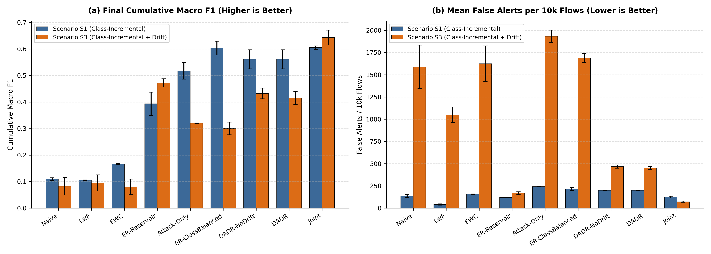
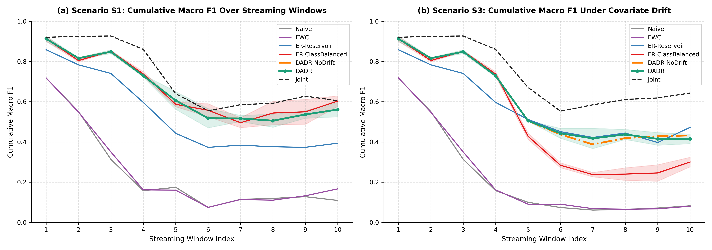
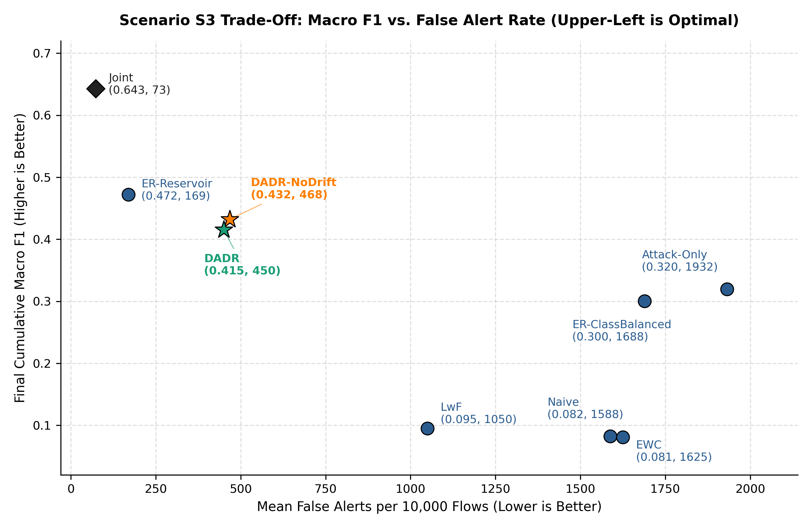
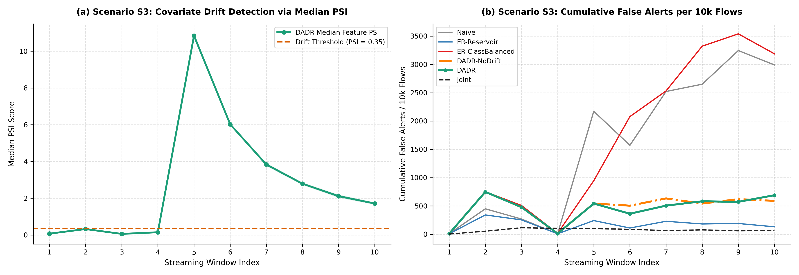
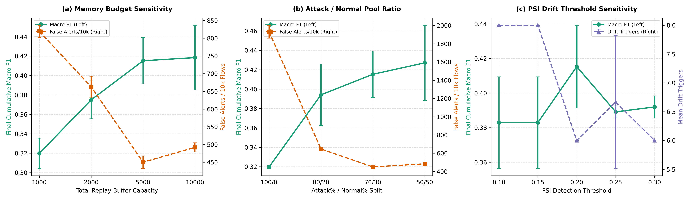

# DADR: Drift-Aware Dual-Pool Experience Replay for Continual Network Intrusion Detection

[](https://www.python.org/)
[](https://pytorch.org/)
[](https://www.unb.ca/cic/datasets/ids-2017.html)

**DADR (Drift-Aware Dual-Pool Experience Replay)** is a memory-bounded continual learning framework for streaming Network Intrusion Detection Systems (NIDS). Under evolving cyber-threat streams characterized by severe class imbalance, abrupt concept drift, and emerging attack families, DADR decouples memory allocation into a **Class-Balanced Attack Pool (70%)** and a **Reservoir Normal Anchor Pool (30%)**, governed by an unsupervised **Population Stability Index (PSI) Drift Detector** that triggers targeted replay buffer refreshes upon distribution shift.

---

## Key Contributions & Highlights

1. **Dual-Pool Memory Decoupling (70% Attack / 30% Normal):** Standard class-balanced replay fails under sudden, heavily imbalanced attack streams (S3), producing 1,688.47 false alerts per 10k flows (ER-ClassBalanced). Reserving 30% of replay capacity strictly for benign traffic anchors the normal decision boundary and reduces false alerts by 73.3% (450.18 vs. 1,688.47 per 10k flows) while maintaining 79.54% cumulative attack recall.

2. **Unsupervised PSI-Triggered Drift Refresh:** Monitoring streaming feature distributions via Population Stability Index (PSI > 0.20) detects sudden concept drift without requiring ground-truth labels at inference time. It refreshes stale buffer samples while maintaining zero false triggers under stationary/sequential streams (S1).

3. **Sub-Linear Streaming Efficiency:** Across 14 sequential traffic windows on CIC-IDS2017, DADR completes streaming training and evaluation in approximately 209 seconds (7.2x faster than offline Joint retraining at 1,511 seconds) within a fixed 5,000-sample memory budget.

---

## Architecture Overview

```text
Streaming Traffic Window (W_t)
│
├──► [1] Unsupervised PSI Drift Monitor (tau_PSI = 0.20)
│         └──► Detects feature distribution shift
│              └──► Triggers Dual-Pool Refresh
│
├──► [2] Dual-Pool Replay Buffer (Total Capacity B = 5,000)
│         ├──► Attack Pool (70% = 3,500)
│         │      └──► Class-balanced across seen attack families
│         └──► Normal Pool (30% = 1,500)
│                └──► Reservoir-sampled benign traffic anchor
│
└──► [3] Continual MLP Classifier (78 -> 256 -> 128 -> C)
          └──► Trained on current window W_t + balanced replay batch
```

---

## Repository Structure

```text
DADR-Continual-IDS/
├── src/
│   ├── config.py             # Global hyperparameters, paths, seeds, and scenario definitions
│   ├── data_loader.py        # CIC-IDS2017 preprocessing, leakage-free scaling, and S1/S3 stream builders
│   ├── model.py              # Continual MLP architecture with dynamic output head expansion
│   ├── replay_buffer.py      # PSI drift detector, Reservoir, Class-Balanced, and Dual-Pool buffers
│   ├── baselines.py          # Naive, Joint, EWC, LwF, ER-Reservoir, ER-ClassBalanced, Attack-Only, DADR
│   ├── metrics.py            # Prequential/Cumulative Macro-F1, Attack Recall, FPR, False Alerts/10k, Forgetting
│   ├── trainer.py            # Streaming window training and evaluation engine
│   └── experiments.py        # Multi-seed benchmark runner and hyperparameter ablation suite
├── scripts/
│   ├── run_main_benchmark.py # Executes 54-checkpoint benchmark (9 methods x 2 scenarios x 3 seeds)
│   ├── plot_results.py       # Generates publication figures (fig1 - fig4)
│   └── run_ablation.py       # Executes S3 hyperparameter sensitivity sweeps and generates fig5
├── results/
│   ├── main_benchmark_summary.csv
│   ├── main_benchmark_raw.csv
│   ├── main_benchmark_windows.csv
│   ├── ablation_budget.csv
│   ├── ablation_ratio.csv
│   ├── ablation_psi.csv
│   └── figures/
│       ├── fig1_s1_vs_s3_comparison.png
│       ├── fig2_window_trajectories.png
│       ├── fig3_f1_vs_false_alerts_tradeoff.png
│       ├── fig4_s3_drift_and_false_alerts.png
│       └── fig5_ablation_study.png
├── requirements.txt
└── README.md
```

---

## Experimental Setup

- **Dataset:** CIC-IDS2017, containing 78 cleaned network flow features across benign traffic and 14 attack classes grouped into major attack families across 14 streaming windows.

- **Evaluation Scenarios:**
  - **Scenario S1 (Sequential Attack Introduction):** New attack families arrive sequentially with balanced normal traffic framing, testing catastrophic forgetting resistance.
  - **Scenario S3 (Sudden Drift + Severe Class Imbalance):** Abrupt multi-attack surges combined with extreme benign/attack skew, testing false-alarm stability and drift recovery.

- **Protocol:** Evaluated over 3 random seeds (42, 101, 202) with fixed replay memory capacity B = 5,000, Adam optimizer (lr = 1e-3), batch size 256, and 5 epochs per streaming window.

---

## Main Benchmark Results (Mean ± Std across 3 Seeds)

### Scenario S1: Sequential Attack Stream

| Method | Final Cum. Macro-F1 | Mean Cum. Macro-F1 | Cum. Attack Recall | False Alerts / 10k | Avg. Forgetting | Runtime (s) |
| --- | --- | --- | --- | --- | --- | --- |
| **Naive (Fine-Tuning)** | $0.1093 \pm 0.0052$ | $0.2460 \pm 0.0026$ | $0.2174 \pm 0.0082$ | $135.57 \pm 16.46$ | $0.5044 \pm 0.0310$ | $228.1$ |
| **EWC** | $0.1668 \pm 0.0014$ | $0.2537 \pm 0.0014$ | $0.2248 \pm 0.0100$ | $156.99 \pm 2.23$ | $0.4410 \pm 0.0249$ | $320.5$ |
| **LwF** | $0.1051 \pm 0.0015$ | $0.1789 \pm 0.0105$ | $0.1004 \pm 0.0114$ | **$41.28 \pm 7.31$** | $0.3817 \pm 0.0325$ | $255.2$ |
| **ER-Reservoir** | $0.3937 \pm 0.0436$ | $0.5322 \pm 0.0179$ | $0.4702 \pm 0.0395$ | $119.60 \pm 3.48$ | $0.3251 \pm 0.0727$ | $232.6$ |
| **ER-ClassBalanced** | **$0.6034 \pm 0.0262$** | **$0.6643 \pm 0.0100$** | **$0.7316 \pm 0.0218$** | $213.45 \pm 17.17$ | $0.1794 \pm 0.0137$ | $223.1$ |
| **Attack-Only** | $0.5173 \pm 0.0311$ | $0.6325 \pm 0.0175$ | $0.7047 \pm 0.0482$ | $242.78 \pm 3.54$ | **$0.1751 \pm 0.0090$** | $230.6$ |
| **DADR-NoDrift** | $0.5610 \pm 0.0359$ | $0.6551 \pm 0.0168$ | $0.7184 \pm 0.0264$ | $200.98 \pm 3.27$ | $0.1802 \pm 0.0143$ | $232.6$ |
| **DADR (Ours)** | $0.5610 \pm 0.0359$ | $0.6551 \pm 0.0168$ | $0.7184 \pm 0.0264$ | $200.98 \pm 3.27$ | $0.1802 \pm 0.0143$ | **$213.0$** |
| *Joint (Offline Upper Bound)* | $0.6050 \pm 0.0064$ | $0.7238 \pm 0.0151$ | $0.7167 \pm 0.0332$ | $124.10 \pm 10.06$ | $0.0672 \pm 0.0408$ | $1510.9$ |

### Scenario S3: Sudden Drift + Class-Imbalanced Stream

| Method | Final Cum. Macro-F1 | Mean Cum. Macro-F1 | Cum. Attack Recall | False Alerts / 10k | Avg. Forgetting | Drift Triggers | Runtime (s) |
| --- | --- | --- | --- | --- | --- | --- | --- |
| **Naive (Fine-Tuning)** | $0.0824 \pm 0.0331$ | $0.2194 \pm 0.0067$ | $0.2363 \pm 0.0297$ | $1588.18 \pm 245.32$ | $0.5514 \pm 0.0641$ | $0.0$ | $239.0$ |
| **EWC** | $0.0807 \pm 0.0286$ | $0.2242 \pm 0.0053$ | $0.2395 \pm 0.0105$ | $1625.21 \pm 200.02$ | $0.4906 \pm 0.0488$ | $0.0$ | $300.8$ |
| **LwF** | $0.0952 \pm 0.0304$ | $0.1708 \pm 0.0132$ | $0.1408 \pm 0.0141$ | $1049.85 \pm 87.79$ | $0.4605 \pm 0.0357$ | $0.0$ | $236.7$ |
| **ER-Reservoir** | **$0.4723 \pm 0.0154$** | $0.5678 \pm 0.0273$ | $0.5411 \pm 0.0645$ | **$169.36 \pm 14.50$** | $0.2591 \pm 0.0062$ | $0.0$ | $211.2$ |
| **ER-ClassBalanced** | $0.3002 \pm 0.0238$ | $0.5042 \pm 0.0104$ | $0.8077 \pm 0.0456$ | $1688.47 \pm 52.01$ | $0.1311 \pm 0.0113$ | $0.0$ | **$202.1$** |
| **Attack-Only** | $0.3197 \pm 0.0016$ | $0.4942 \pm 0.0097$ | **$0.8136 \pm 0.0500$** | $1931.87 \pm 70.94$ | **$0.1219 \pm 0.0075$** | $0.0$ | $211.8$ |
| **DADR-NoDrift** | $0.4324 \pm 0.0201$ | $0.5916 \pm 0.0072$ | $0.8017 \pm 0.0423$ | $467.93 \pm 17.69$ | $0.1289 \pm 0.0191$ | $0.0$ | $212.8$ |
| **DADR (Ours)** | $0.4153 \pm 0.0239$ | **$0.5940 \pm 0.0063$** | $0.7954 \pm 0.0324$ | $450.18 \pm 17.88$ | $0.1889 \pm 0.0397$ | **$6.0$** | $208.8$ |
| *Joint (Offline Upper Bound)* | $0.6431 \pm 0.0281$ | $0.7314 \pm 0.0151$ | $0.7245 \pm 0.0284$ | $72.98 \pm 6.96$ | $0.0384 \pm 0.0374$ | $0.0$ | $1511.3$ |

---

## Visual Benchmark Summary

### Figure 1. Cross-Scenario Macro-F1 Comparison (S1 vs. S3)



### Figure 2. Streaming Cumulative Macro-F1 Trajectories



### Figure 3. Operational Detection vs. False-Alert Pareto Trade-off



### Figure 4. Scenario S3 PSI Drift Detection and False-Alarm Suppression



---

## Hyperparameter Ablation Study (Scenario S3)

To validate DADR's architectural choices, we conducted single-factor sensitivity sweeps across **Memory Budget (B)**, **Attack/Normal Pool Split**, and **PSI Drift Threshold (tau_PSI)** on Scenario S3 using 3 random seeds.

| Ablation Dimension | Setting | Mean Cum. Macro-F1 | Final Cum. Macro-F1 | Cum. Attack Recall | False Alerts / 10k | Drift Triggers |
| --- | --- | --- | --- | --- | --- | --- |
| **Memory Budget (B)** | $1,000$ | $0.5368 \pm 0.0137$ | $0.3198 \pm 0.0156$ | $0.7355 \pm 0.0337$ | $819.48 \pm 17.19$ | $6.33 \pm 0.58$ |
| **Memory Budget (B)** | $2,000$ | $0.5589 \pm 0.0046$ | $0.3750 \pm 0.0195$ | $0.7694 \pm 0.0506$ | $663.00 \pm 29.57$ | $6.00 \pm 0.00$ |
| **Memory Budget (B)** | **$5,000 (Default)$** | **$0.5940 \pm 0.0063$** | $0.4153 \pm 0.0239$ | $0.7954 \pm 0.0324$ | **$450.18 \pm 17.88$** | $6.00 \pm 0.00$ |
| **Memory Budget (B)** | $10,000$ | $0.5931 \pm 0.0164$ | **$0.4185 \pm 0.0334$** | **$0.8084 \pm 0.0463$** | $492.01 \pm 12.96$ | $6.00 \pm 0.00$ |
| **Pool Ratio (Att/Norm)** | $100\% / 0\%$ | $0.4942 \pm 0.0097$ | $0.3197 \pm 0.0016$ | $0.8136 \pm 0.0500$ | $1931.87 \pm 70.94$ | $0.00 \pm 0.00$ |
| **Pool Ratio (Att/Norm)** | $80\% / 20\%$ | $0.5848 \pm 0.0063$ | $0.3941 \pm 0.0317$ | **$0.8495 \pm 0.0119$** | $646.67 \pm 16.24$ | $8.00 \pm 0.00$ |
| **Pool Ratio (Att/Norm)** | **$70\% / 30\% (Default)$** | **$0.5940 \pm 0.0063$** | $0.4153 \pm 0.0239$ | $0.7954 \pm 0.0324$ | **$450.18 \pm 17.88$** | $6.00 \pm 0.00$ |
| **Pool Ratio (Att/Norm)** | $50\% / 50\%$ | $0.5832 \pm 0.0119$ | **$0.4271 \pm 0.0387$** | $0.8034 \pm 0.0593$ | $484.24 \pm 17.05$ | $8.00 \pm 0.00$ |
| **PSI Threshold (tau_PSI)** | $0.10$ | $0.5737 \pm 0.0014$ | $0.3829 \pm 0.0266$ | **$0.8201 \pm 0.0452$** | $561.78 \pm 19.55$ | $8.00 \pm 0.00$ |
| **PSI Threshold (tau_PSI)** | $0.15$ | $0.5737 \pm 0.0014$ | $0.3829 \pm 0.0266$ | **$0.8201 \pm 0.0452$** | $561.78 \pm 19.55$ | $8.00 \pm 0.00$ |
| **PSI Threshold (tau_PSI)** | **$0.20 (Default)$** | **$0.5940 \pm 0.0063$** | **$0.4153 \pm 0.0239$** | $0.7954 \pm 0.0324$ | **$450.18 \pm 17.88$** | $6.00 \pm 0.00$ |
| **PSI Threshold (tau_PSI)** | $0.25$ | $0.5751 \pm 0.0025$ | $0.3891 \pm 0.0035$ | $0.8089 \pm 0.0550$ | $569.76 \pm 9.65$ | $6.67 \pm 1.15$ |
| **PSI Threshold (tau_PSI)** | $0.30$ | $0.5749 \pm 0.0028$ | $0.3919 \pm 0.0064$ | $0.7981 \pm 0.0364$ | $572.25 \pm 12.04$ | $6.00 \pm 0.00$ |

### Figure 5. Hyperparameter Ablation Study



---

## Reproducing the Experiments

### 1. Installation

```bash
git clone https://github.com/ayesha-ml/DADR-Continual-IDS.git
cd DADR-Continual-IDS
pip install -r requirements.txt
```

### 2. Dataset Preparation

Download the official **CIC-IDS2017** MachineLearningCSV archive from the Canadian Institute for Cybersecurity and place the 8 CSV files inside `raw_data/cicids2017/` (configured via `Config.RAW_DATA_DIR` in `src/config.py`).

### 3. Run Full Benchmark and Generate Figures

```bash
# Execute the 54-checkpoint main benchmark across scenarios S1 and S3
python -m scripts.run_main_benchmark

# Generate Figures 1 through 4
python -m scripts.plot_results

# Execute Scenario S3 hyperparameter ablation and generate Figure 5
python -m scripts.run_ablation
```

---

## Acknowledgements

The experiments use the CIC-IDS2017 dataset provided by the Canadian Institute for Cybersecurity at the University of New Brunswick.
